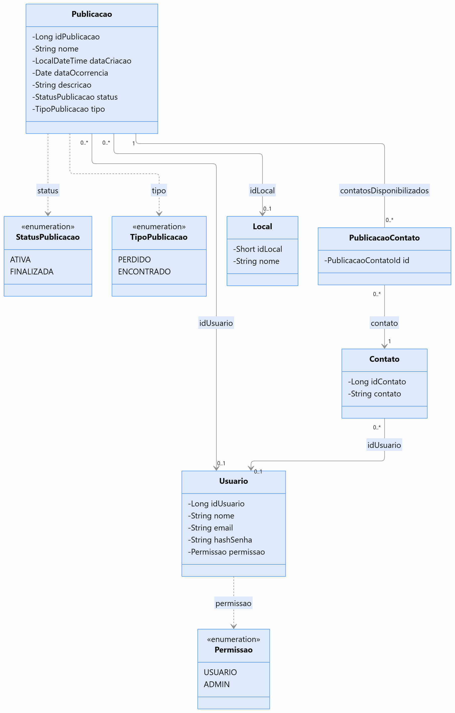

# Achados e Perdidos da UNIFIO

*Projeto Integrador de Engenharia de Software · Back-end*

O Achados e Perdidos da UNIFIO aproxima quem perdeu um objeto no campus de quem o encontrou. A comunidade acadêmica pode publicar e consultar anúncios com a descrição do item, a data, o local e os meios de contato para combinar a devolução.

## Objetivo do back-end

A API autentica os usuários e gerencia as publicações de itens perdidos e encontrados. Cada anúncio reúne o autor, o local da ocorrência e os contatos que ele escolheu disponibilizar. A API também registra se a publicação está ativa ou finalizada.

## Tecnologias utilizadas

| Tecnologia | Uso no projeto |
| --- | --- |
| Java 21 e Spring Boot | Desenvolvimento da API REST |
| Spring Security | Autenticação e controle de acesso |
| Spring Data JPA, Hibernate e MySQL | Mapeamento das entidades e persistência dos dados |
| Jakarta Validation | Validação dos dados recebidos pela API |
| Maven Wrapper | Resolução de dependências e execução da aplicação |
| Docker Compose e Dev Containers | Configuração do ambiente de desenvolvimento com Java e MySQL |

## Como executar

1. Utilize um codespaces

2. Entre no codespaces e configure o container caso necessário

3. Execute a aplicação

4. O nome, o usuário e a senha do banco de dados estão no arquivo .devcontainer

## Diagrama de classes

O diagrama apresenta as cinco entidades do sistema, seus relacionamentos e os enums que definem a permissão do usuário, o tipo e o status de cada publicação.

## Contas De Teste

USUARIO:
Nome: ContaUsuario01
E-Mail: usuario01@unifio.edu.br
Senha: senhaforte123

ADMIN:
Nome: Adm12345
E-Mail: administrador01@unifio.edu.br
Senha: senhateste456

*Nota: todas essas contas são apenas para fins de teste, não possuem informações reais, para utilizar elas, mude o application.properties e mudem as configurações do banco de update para create*

## Evidências

As evidências estão no arquivo postman do docs, siga as instruções corretamente, não esqueça dos tokens Csrf e do cabeçalho.

## Integrantes

| Nome | RA |
| --- | --- |
| Luís Miguel Cassoni | 273195 |
| Luiz Henrique Azevedo Campese | 273740 |
| Vinicius Pavani Tossi | 271145 |
| Vinicius Francisco dos Santos Ramos | 272586 |
